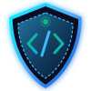

<p align="center">
  
  <br>
  <h1 align="center">AegisCode</h1>
  <p align="center"><em>Intelligent Developer Security, Automated Code Review &amp; Supply Chain Guardrails</em></p>
</p>

<p align="center">
  <a href="LICENSE"></a>
  
  
  
</p>

---

## Overview

**AegisCode** is an open, self-hosted developer security platform designed to intercept vulnerabilities, secret leaks, and architectural flaws directly in pull and merge requests before they reach production.

Operating across **GitHub**, **GitLab**, **Azure DevOps**, and **Forgejo**, AegisCode inspects code changes using deep AST analysis, semantically aware AI models, and policy guardrails, posting precise inline security findings and automated remediation patches.

## Key Security Pillars

- 🛡️ **Zero-Exposure Secret Scanning:** Intercepts leaked API keys, database credentials, JWT secrets, and private keys within pull request diffs before code merge.
- 🔍 **OWASP Top 10 & CWE Weakness Detection:** Enforces secure coding standards (SQL/Command Injection, SSRF, XSS, Path Traversal, Insecure Deserialization, Broken Access Control) with context-aware semantic analysis.
- 📦 **Supply Chain & SBOM Guardrails:** Tracks dependencies, flags known CVEs, and prevents malicious or unlicensed package introductions.
- 💡 **Automated Remediation Diffs:** Generates synthesized, copy-pasteable or one-click fix patches for security findings directly in SCM review threads.
- 🔒 **Zero Code Exfiltration (Self-Hosted):** You control where code and data reside. AegisCode runs entirely within your perimeter, connecting directly to your SCM hosts and self-managed AI gateways.
- 🤖 **Bring Your Own AI (BYO-AI):** Connect Azure OpenAI, OpenAI, Anthropic Claude, AWS Bedrock, Google Vertex AI, LiteLLM gateways, or local LLMs (e.g. Ollama, vLLM). No proprietary AI models or third-party training on your proprietary code.
- 🏢 **Multi-Tenancy & Fleet Runners:** Scalable multi-tenant architecture with distributed runner fleet management, thread memory resolution, and tenant-scoped budgets.

## Quickstart

The fastest way to deploy AegisCode for evaluation is via the bundled Docker Compose stack:

```bash
# 1. Clone the repository
git clone https://github.com/meister-dev-ai/propr.git aegiscode
cd aegiscode

# 2. Configure the environment
cp example/docker-compose/.env.example example/docker-compose/.env
# Edit example/docker-compose/.env with your JWT secret and database credentials

# 3. Launch the platform
cd example/docker-compose
docker compose up --build
```

Access the AegisCode Security Console at **`https://localhost:5443`**.

## Development Setup

### Backend (.NET 10)
```powershell
# Restore dependencies and build solution
dotnet restore MeisterDev.ProPR.slnx
dotnet build MeisterDev.ProPR.slnx --no-restore

# Run local API host
dotnet run --project src/MeisterDev.ProPR.Api/MeisterDev.ProPR.Api.csproj
```

### Frontend (Vue 3 + Vuetify)
```bash
cd frontend
npm install

# Run in mock mode (MSW simulated security fixtures)
npm run mock

# Run against local live backend
npm run dev

# Run full test suite & type verification
npm test
npm run type-check
npm run build
```

## Architecture & Configuration

AegisCode supports flexible configuration through both modern `AEGIS_*` variables and backwards-compatible `MEISTER_*` environment bindings:

| Variable | Description |
|---|---|
| `AEGIS_JWT_SECRET` | 256-bit cryptographic key used for HS256 authentication tokens |
| `AEGIS_BOOTSTRAP_ADMIN_USER` | Initial administrative user seeded on empty database initialization |
| `AEGIS_BOOTSTRAP_ADMIN_PASSWORD` | Initial password for the administrator account |
| `AEGIS_PUBLIC_BASE_URL` | Public base endpoint advertised to SCM webhook listeners |
| `DB_CONNECTION_STRING` | PostgreSQL connection string (with pgvector support enabled) |

## Documentation

Full architectural and operational guides are organized under `docs/`:
- [Quickstart Guide](docs/quickstart.md)
- [Architecture & Boundaries](docs/architecture/scm-provider-boundaries.md)
- [Code Insights & Hotspots](docs/architecture/code-insights.md)
- [Security & Ingress Reference](docs/reference/security.md)
- [Product Transformation Report](docs/PRODUCT_TRANSFORMATION_REPORT.md)

## License & Attribution

AegisCode contains and builds upon technology originally authored by **Andreas Rain** under the **Elastic License 2.0 (ELv2)**.

- Original Copyright (c) Andreas Rain. All rights reserved.
- Distributed under the terms of the [Elastic License 2.0](LICENSE).
- See [NOTICE](NOTICE) and [LICENSING.md](LICENSING.md) for complete license policies and attribution.
