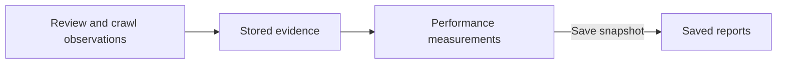

# Code Insights architecture

Code Insights collects review evidence and provides reviewer-performance measurements and saved reports.
Collection requires the commercial Code Insights capability and an enabled client collection policy.

For chart controls and score interpretation, see [Reviewer performance](../concepts/reviewer-performance.md).

## Collection

Reviewing and Crawling supply observations through provider-neutral contracts. Code Insights owns analytics
storage and calculations; PostgreSQL stores the evidence. Collection failures do not interrupt reviews,
comment publication or thread memory.

The durable job result is stored before awaited completion hooks and analytics intake. A heartbeat
that observes successful completion of its generation stops renewal without canceling that work.
Host shutdown, caller cancellation and stale lease generations retain their cancellation behavior.

## Evidence and identity

| Evidence | Retained information |
|---|---|
| Reviewer findings | ProPR records the producing model, finding type and kind, publication, outcome and duplicate evidence. |
| Human concerns | ProPR records the discussion, substantive and acted-on judgments, scope, classification and collection coverage. |
| File reviews | ProPR records which model reviewed a file. This does not establish which human concerns that model missed. |

Evidence is associated with its client, provider host or organization, repository and pull request.
Repeated observations of one publication count once; suppressed repeats receive no additional publication
credit. Connection edits do not change a captured source identity.

Missing source identity, classification or judgment remains visible as unknown.

Verification-withheld candidates retain their original comment, model and pass provenance, scope,
grounding and withholding reason separately from publishable comments. File checkpoints store this
evidence in nullable JSONB and restore it during job recovery. Resetting a file retry clears its old
evidence. Synthesis excludes carried-forward file evidence from the newly produced population.
Runner checkpoints, prior results and final annotations carry the same optional evidence.

Completed job results retain the full withheld collection in the existing result JSON independently
of collection authorization or success. An Infrastructure persistence serializer includes this internal
field; default HTTP serialization omits it. Older results without the field read as an empty collection.

Final review collection gives these candidates negative ordinals in a deterministic order, separate
from the nonnegative publication-candidate ordinals. Changes in the published population cannot reuse
their identities. They are `PolicyWithheld` observations without provider thread or comment receipts and contribute
to withheld coverage counts. They receive no publication or settled precision credit. Capability and
client collection-policy checks apply to this evidence through the existing collection path.

Thread observations update current outcomes, including reopened threads. A human concern that matches a
reviewer finding or contains an AI-authored comment is excluded from miss counts; its recorded judgments
remain available.

Current thread observations receive neutral resolution intent from provider policies. Providerless
stored discussion text uses an explicit compatibility decoder for the historical
service-account identifier, summary prefix and generated-marker grammar. Those exclusions remain
global because the retained text does not establish a provider family or current runtime capability.
Disposition, harvesting and history import obtain normalized intent for saved discussion statuses through
the credential-free compatibility codec. Their account and publication exclusions retain the separate
providerless stored-evidence decoder.

Discussion consumers share one provider observation. PostgreSQL records independent consumer progress
so failed consumers can retry without repeating completed work. Collection and archive policies still
apply, and immutable measurements require acknowledged final evidence.

## Measurements

Performance measurements apply scoring premises to stored counts. Counts refresh as evidence is collected,
and background catch-up recovers missed updates. Filtering and range calculations reuse those counts.
Side-by-side views use a consistent set of evidence. Each view shows its latest evidence update time and
pending-update status separately from the response capture time.

The catch-up worker projects findings and seals eligible pull requests before refreshing retained
provider evidence, including closed pull requests and reviews with no findings. Durable claims and
leases prevent stale completion; unavailable evidence retries after a cooldown. Cancellation and lease
expiry prevent completion, and the worker waits for active operation cleanup. Attempt metadata does not
extend retention or change scores. [Configuration](../operate/configuration.md#code-insights) lists the
batch and time limits.

Candidate selection and managed gap qualification use the same whitespace rules for missing evidence
and native statuses. Nonempty source namespaces retain exact comparisons.

Historical sources use captured job coordinates and exact client, repository and pull-request ownership.
Missing finding or exposure namespaces are recovered from their own retained jobs. Human concerns and
coverage without a namespace require one unambiguous captured source. Existing namespaces remain fixed;
current connection edits do not establish historical identity. Conflicting human judgments remain
separate and unavailable. Corrected coverage requires a fresh complete provider read, and thread
eligibility retains its latest source watermark and exclusion state.

Source observation timestamps mark the read start; completion timestamps are stored separately.
This orders concurrent observations so a delayed response cannot replace newer retained evidence.
Unexpected historical failures log the unavailable stage, exception type and numeric diagnostic code
without exception messages, stack traces or payloads.

Each publication, human concern and source requires acknowledged retention before a claim completes.
Partial enumeration or missing identity keeps collection unavailable. Infrastructure selects ordinary
close reads and strict historical reads. Forgejo supports ordinary close collection; historical thread
correlation is unavailable. PR-wide comment receipts require one unique observed thread. Thread-local
comment receipts require the captured thread identity.

Consistent historical outcomes and human concerns preserve successful judgments, classifier provenance,
dimensions and judged discussion. Changed evidence uses bounded classification. Completed retained
populations consume no further provider or model calls. Live projections refresh; initial dispositions,
sealed measurements and saved reports retain their stored values.

Precision, recall and F1 are unavailable when their required evidence or denominator is missing. Incomplete
collection prevents supported recall. Model-specific precision is supported; model-specific recall and F1
lack compatible human-miss attribution. Recall and F1 by type or kind require compatible miss classification.
The API retains raw counts and scoring premises. The user interface presents metric ranges and evidence
limitations.

The [API reference](../reference/api.md#reviewer-performance) defines query limits and request fields.

## Saved reports and deletion

A saved report captures its scope, counts, scoring premises, results and evidence cutoff. Opening the report
uses that captured response without recalculation. Its evidence update time and pending-update status
describe the capture. Every report operation requires access to all included clients.

| Event | Effect on saved reports |
|---|---|
| Evidence or scoring changes | Saved reports retain their captured results. |
| Collection is disabled | Collection stops; authorized saved reports remain available until expiry or deletion. |
| Source evidence expires | Saved reports follow their own retention period. |
| A report expires or is deleted | ProPR removes the complete report. |
| A client or its collection data is deleted | ProPR removes every report containing that client's data, including reports spanning several clients. |

[Configuration](../operate/configuration.md#code-insights) defines collection, background processing and
retention settings. [Security](../reference/security.md) describes tenant access.
